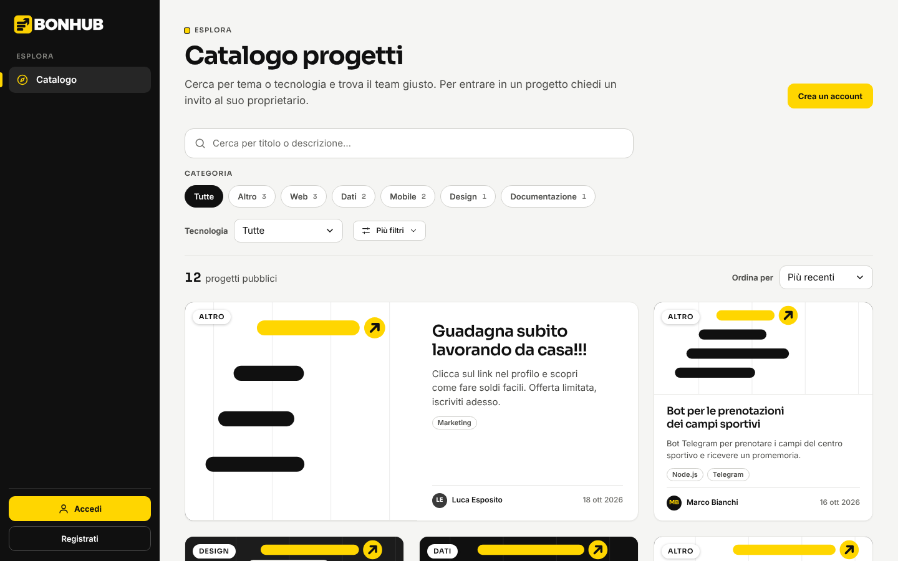
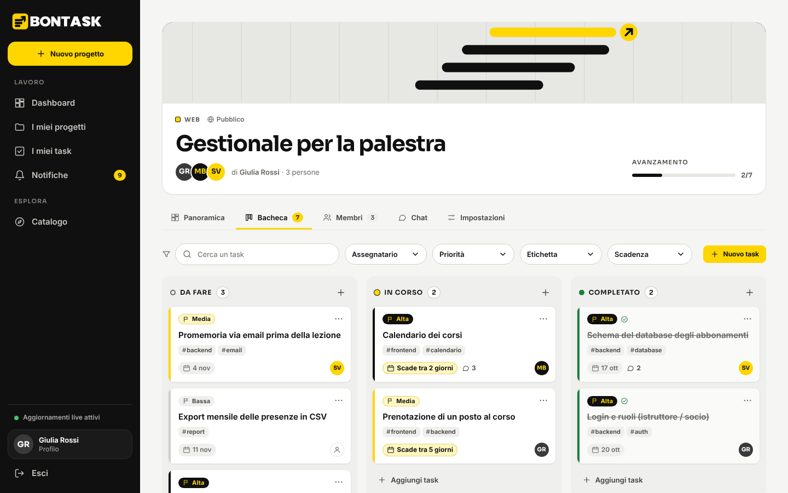
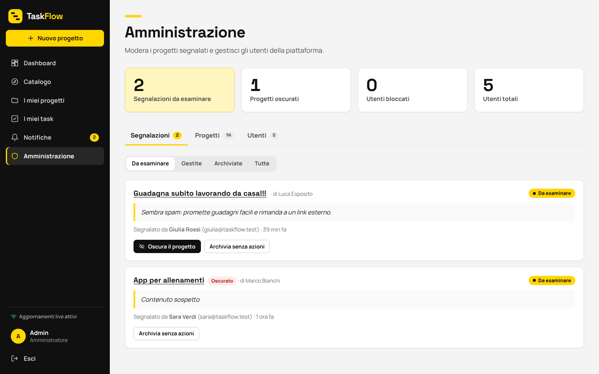

# BONHUB

> BONHUB è l'applicazione sviluppata per la consegna TaskFlow.

Piattaforma collaborativa di gestione progetti: **bacheca a colonne** (Da fare · In corso · Completato), **chat** e **notifiche in tempo reale**, **catalogo pubblico** filtrabile e **pannello di moderazione** per gli amministratori. Progetto d'esame finale di Node.js.

**Identificativi tecnici invariati.** Il nome del marchio è cambiato, ma database (`taskflow`, `taskflow_test`), chiave di sessione nel browser (`taskflow_token`), nome del container Docker e dominio degli account dimostrativi (`@taskflow.test`) restano quelli originali, così i dati e le sessioni esistenti continuano a funzionare.



| Bacheca (aggiornata in tempo reale) | Pannello amministrativo |
| --- | --- |
|  |  |

> Per la discussione orale vedi la **[guida all'esame](docs/GUIDA_ORALE.md)**.
>
> **Vetrina per il portfolio:** `docs/index.html` è una pagina statica con descrizione, schermate e tecnologie. Per pubblicarla con GitHub Pages: *Settings → Pages → Branch `main` → cartella `/docs`*. L'applicazione completa non può girare su Pages (servono backend e MongoDB): si avvia in locale come descritto sotto.

## Indice

1. [Avvio rapido](#avvio-rapido)
2. [Script npm](#script-npm)
3. [Configurazione](#configurazione)
4. [Struttura del progetto](#struttura-del-progetto)
5. [Modelli e relazioni](#modelli-e-relazioni)
6. [Autenticazione, ruoli e permessi](#autenticazione-ruoli-e-permessi)
7. [Funzionamento del realtime](#funzionamento-del-realtime)
8. [API REST](#api-rest)
9. [Frontend e identità visiva](#frontend-e-identità-visiva)
10. [Test e verifiche](#test-e-verifiche)
11. [Scelte implementative](#scelte-implementative)
12. [Limiti noti](#limiti-noti)
13. [Licenze](#licenze)

## Avvio rapido

Servono **Node.js 20.19+** (o 22+) con npm e **MongoDB**. Per MongoDB scegli una strada:

- **Docker:** `docker compose up -d` (usa il `docker-compose.yml` nella radice)
- **MongoDB Community** installato in locale (porta 27017)
- **MongoDB Atlas** (cluster gratuito): metti la stringa di connessione in `MONGO_URI`

Poi, in **due terminali**:

```bash
# Terminale 1 – backend → http://localhost:4000
cd backend
npm install
cp .env.example .env        # su Windows: copy .env.example .env
npm run seed                # dati dimostrativi (non cancella nulla)
npm run dev

# Terminale 2 – frontend → http://localhost:5173
cd frontend
npm install
npm run dev
```

Apri **http://localhost:5173**. In sviluppo Vite inoltra `/api`, `/uploads` e `/socket.io` al backend (`frontend/vite.config.js`): non servono impostazioni CORS.

### Account dimostrativi

Creati da `npm run seed`:

| Ruolo | Email | Password |
| --- | --- | --- |
| Amministratore | `admin@taskflow.test` | `admin1234` |
| Utente | `giulia@taskflow.test` | `password123` |
| Utente | `marco@taskflow.test` | `password123` |
| Utente | `sara@taskflow.test` | `password123` |
| Utente | `luca@taskflow.test` | `password123` |
| Utente | `chiara@taskflow.test` · `davide@taskflow.test` · `elisa@taskflow.test` | `password123` |

Su un database vuoto il seed crea **8 utenti e 15 progetti** (pubblici, privati, uno archiviato) con **43 task con etichette**, **19 commenti**, la **cronologia delle attività** di ogni progetto, 16 messaggi di chat, notifiche, **5 inviti** (4 in attesa e 1 rifiutato) e **2 segnalazioni** (una aperta da moderare, un progetto-spam di Luca, e una già archiviata dall'admin). **Non cancella nulla:** ogni utente, progetto, task, commento, invito e segnalazione viene creato solo se manca (e i progetti demo già presenti vengono completati con etichette, commenti e cronologia), quindi si può rilanciare e si può usare su un database con dati veri. Si rifiuta di partire con `NODE_ENV=production`.

**Per vedere il tempo reale:** apri due finestre (una in incognito), entra come Giulia e come Marco nello stesso progetto, poi sposta un task, scrivi in chat o invita qualcuno: l'altra finestra si aggiorna da sola.

## Script npm

| Cartella | Comando | Cosa fa |
| --- | --- | --- |
| `backend` | `npm run dev` | avvia l'API con riavvio automatico (nodemon) |
| `backend` | `npm start` | avvia l'API (produzione) |
| `backend` | `npm run seed` | aggiunge i dati dimostrativi (non distruttivo) |
| `backend` | `npm test` | test di integrazione (Jest + Supertest + Socket.IO) |
| `frontend` | `npm run dev` | server di sviluppo Vite |
| `frontend` | `npm run build` | build di produzione in `frontend/dist` |
| `frontend` | `npm run preview` | anteprima della build |
| `e2e` | `npm test` | test end-to-end nel browser (vedi [e2e/README.md](e2e/README.md)) |

## Configurazione

`backend/.env` (parti da `.env.example`, che non contiene segreti):

| Variabile | Default | Significato |
| --- | --- | --- |
| `PORT` | `4000` | porta del backend |
| `MONGO_URI` | `mongodb://127.0.0.1:27017/taskflow` | database |
| `JWT_SECRET` | `cambia-questo-segreto` | chiave per firmare i token: **cambiala**. Con `NODE_ENV=production` il backend non parte se è quella di default |
| `JWT_EXPIRES_IN` | `7d` | durata del token |
| `CLIENT_URL` | `http://localhost:5173` | origine consentita da CORS e Socket.IO |
| `NODE_ENV` | — | `production` attiva i controlli di sicurezza sull'avvio |

I test usano il database `taskflow_test` (cambiabile con `MONGO_URI_TEST`) e lo svuotano: non toccano `taskflow`.

## Struttura del progetto

```
backend/
  src/
    app.js              configura Express (middleware, rotte, errori): usato anche dai test
    server.js           connette il database e avvia HTTP + Socket.IO
    config/             env.js (variabili), db.js (connessione), migrate.js (migrazioni idempotenti)
    models/             User, Project, Task, TaskComment, Activity, Message, Notification,
                        Invitation, Report, RevokedToken
    middleware/         auth (JWT), projectAccess (ruoli sul progetto), upload (copertine),
                        errorHandler, rateLimit, security, validateId
    controllers/        la logica di ogni area (auth, progetti, membri/inviti, task, commenti,
                        cronologia, chat, dashboard, notifiche, segnalazioni, admin)
    routes/             associano URL → middleware → controller
    sockets/            index.js (autenticazione e room), emit.js (eventi, notifiche, espulsioni)
    utils/              AppError, validate (Validator), token, pagination, projectData,
                        activity (registro delle attività)
  scripts/              seed.js + demoData.js
  tests/                integrazione: auth, progetti, inviti, task/chat, commenti/etichette/
                        cronologia, admin, realtime
  uploads/              copertine caricate (non versionate)
frontend/
  src/
    api.js              client REST (token, errori per campo, fine sessione)
    context/            Auth, Toast, Confirm, Realtime (una sola connessione Socket.IO)
    hooks/              useAsync, useUrlFilters, useProjectTasks, ...
    components/         Layout, Board, Chat, TaskModal, MembersTab, Modal, DropdownMenu, ...
    pages/              Catalog, Dashboard, MyProjects, MyTasks, Notifications, Profile,
                        ProjectPage, NewProject, Admin, accesso/registrazione
    styles/             tokens.css (palette, font, spaziature, raggi, ombre, movimento), base.css (gerarchia
                        tipografica), ui.css (componenti condivisi), layout.css (barra laterale, tablet, mobile)
                        + un file per area: auth, catalog, work, forms, project, board, admin
  public/brand/         logo BONHUB (PNG trasparenti: scritta nera, scritta bianca, sola icona) e icone
postman/                collection + environment
e2e/                    test end-to-end (Playwright + axe-core)
docs/                   guida all'esame e immagini
```

## Modelli e relazioni

```
User ──< Project (owner)            Un progetto ha un proprietario e molti membri (User)
User >──< Project (members)
Project ──< Task ──> User           Un task ha un assegnatario (un membro) e un autore
Task ──< TaskComment ──> User         Commenti sul singolo task
Project ──< Activity ──> User       Cronologia delle attività del progetto
Project ──< Message ──> User        Chat del progetto
Project ──< Invitation ──> User     Invito a un utente (pending / accepted / declined / cancelled)
Project ──< Report ──> User         Segnalazione (open / dismissed / actioned)
User ──< Notification ──> Project|Task|Invitation   Notifica collegata alla risorsa
RevokedToken                        Token invalidati dal logout (indice TTL: spariscono alla scadenza)
```

| Modello | Campi principali |
| --- | --- |
| **User** | name, email (unica), passwordHash (bcrypt), role (`user`/`admin`), blocked, passwordChangedAt |
| **Project** | title, description, category, technologies[], visibility (`public`/`private`), coverImage, owner, members[], status (`active`/`archived`/`hidden`) |
| **Task** | project, title, description, dueDate, priority (`low`/`medium`/`high`), status (`todo`/`in_progress`/`done`), assignee, **labels[]** (max 5, max 20 caratteri), createdBy |
| **TaskComment** | project, task, author, text (max 1000 caratteri) |
| **Activity** | project, actor, type, text, task — registro di chi ha fatto cosa nel progetto |
| **Message** | project, author, text (chat del progetto) |
| **Notification** | user, type, text, project, task, invitation, read |
| **Invitation** | project, invitee, inviter, status — un solo invito `pending` per coppia progetto/utente (indice parziale unico) |
| **Report** | project, reporter, reason, status, resolvedBy, resolvedAt, adminNote |

Le password non sono mai incluse nelle risposte (`toJSON` rimuove `passwordHash`).

## Autenticazione, ruoli e permessi

- **JWT** (`Authorization: Bearer <token>`), firmato con `JWT_SECRET`. Ogni richiesta verifica firma, scadenza, revoca (logout), blocco dell'utente e cambio password (`utils/token.js`). La stessa funzione protegge anche la connessione Socket.IO.
- **Logout reale:** l'id del token (`jti`) finisce in `RevokedToken` fino alla scadenza e le connessioni live di quel token vengono chiuse.
- **Sessione scaduta:** il frontend riconosce `401` con codice `session_invalid` (o `403 account_blocked`), pulisce la sessione e riporta al login con un avviso.
- **Anti forza bruta:** massimo 10 tentativi di login ogni 15 minuti per coppia IP+email (in memoria, `middleware/rateLimit.js`).
- **Password:** hash bcrypt, minimo 8 caratteri; cambiandola, i token emessi prima smettono di valere.
- **"Proprietario" non è un ruolo globale:** è chi risulta `owner` di quel progetto. Il middleware `loadProject` calcola `isOwner`/`isMember` per ogni rotta con `:id`; `admin` è invece un campo dell'utente.

| Azione | Visitatore | Utente | Membro | Proprietario | Admin |
| --- | :-: | :-: | :-: | :-: | :-: |
| Sfogliare il catalogo e i filtri | ✓ | ✓ | ✓ | ✓ | ✓ |
| Vedere la panoramica di un progetto pubblico | — | ✓ | ✓ | ✓ | ✓ |
| Vedere un progetto privato | — | — | ✓ | ✓ | ✓ (moderazione) |
| Vedere bacheca e chat | — | — | ✓ | ✓ | — |
| Creare/modificare task, scrivere in chat | — | — | ✓ | ✓ | — |
| Invitare, annullare inviti, rimuovere membri | — | — | — | ✓ | — |
| Modificare, archiviare, eliminare il progetto | — | — | — | ✓ | — |
| Creare un progetto, rispondere agli inviti, segnalare | — | ✓ | ✓ | ✓ | ✓ |
| Lasciare un progetto | — | — | ✓ | — | — |
| Oscurare progetti, gestire segnalazioni, bloccare utenti | — | — | — | — | ✓ |

I controlli sono sempre **sul server**: nascondere un pulsante nell'interfaccia non basta e non è l'unica difesa. Una visibilità pubblica non dà mai accesso a task e chat. Gli estranei, inoltre, non vedono le email dei membri.

### Stati del progetto

| Stato | Chi lo imposta | Catalogo | Scritture (task, chat, inviti, modifiche) | Accesso |
| --- | --- | :-: | --- | --- |
| `active` | — | se pubblico | consentite | come da tabella sopra |
| `archived` | proprietario | no | **bloccate** (`409`), lettura consentita | invariato; il proprietario può riattivarlo |
| `hidden` | admin | no | **bloccate** (`409`) | solo proprietario (sola lettura) e admin; i membri ricevono `403` e perdono le connessioni live |

**Cosa succede quando…**

- **si rimuove un membro** (o esce da solo): perde accesso a bacheca e chat, i task che gli erano assegnati restano senza assegnatario (le bacheche si aggiornano live), esce dalla room Socket.IO e riceve una notifica;
- **si archivia un progetto:** diventa di sola lettura per tutti, a livello di API e di interfaccia, in tempo reale;
- **si elimina un progetto** (con conferma): si cancellano task, commenti, cronologia, messaggi, inviti, segnalazioni, notifiche collegate e la copertina; chi è connesso riceve `project:deleted` e viene tolto dalla room;
- **un admin oscura un progetto:** esce dal catalogo, le segnalazioni aperte diventano "gestite", il proprietario viene avvisato e i membri (tranne lui) vengono espulsi dalla room;
- **un admin blocca un utente:** token rifiutati (`403`) e login negato; i suoi socket ricevono `session:ended` e vengono chiusi subito.

## Funzionamento del realtime

Socket.IO affianca le API REST, **non le sostituisce**: ogni azione passa da una richiesta HTTP, viene salvata su MongoDB e solo dopo il server emette l'evento. Quindi tutto funziona anche senza socket (Postman compreso) e un client che si riconnette recupera ciò che ha perso con una normale GET.

1. Il client si connette con `io({ auth: { token } })`. Il server verifica il JWT (`sockets/index.js`) e rifiuta chi non è autenticato.
2. Inserisce il socket nelle room `user:<id>` (notifiche e inviti personali) e `project:<id>` per ogni progetto di cui è proprietario o membro (quelli oscurati solo al proprietario).
3. I controller emettono dopo il salvataggio, tramite `sockets/emit.js`:

| Evento | Room | Quando |
| --- | --- | --- |
| `task:created` · `task:updated` · `task:moved` · `task:deleted` | `project:<id>` | un task cambia |
| `chat:message` | `project:<id>` | nuovo messaggio |
| `comment:created` · `comment:deleted` | `project:<id>` | commento su un task |
| `activity:new` | `project:<id>` | nuova voce nella cronologia del progetto |
| `member:joined` · `member:removed` | `project:<id>` | cambia la lista membri |
| `project:updated` · `project:deleted` | `project:<id>` | modifica, archivio, oscuramento, cancellazione |
| `notification:new` | `user:<id>` | task assegnato, spostato o commentato, nuovo membro, invito, segnalazione (agli admin), oscuramento |
| `invitation:created` · `invitation:updated` | `user:<id>` | invito ricevuto o annullato |
| `session:ended` | socket | blocco, logout, scadenza del token |

4. **Accessi live:** chi viene rimosso lascia la room; chi viene bloccato o fa logout viene disconnesso; la connessione si chiude anche alla scadenza del token.
5. **Riconnessione:** il frontend mostra lo stato ("Aggiornamenti live attivi" / "Riconnessione in corso…") e, appena si riconnette, ricarica task, chat e contatori (`resyncKey` in `RealtimeContext`). I messaggi non vengono mai duplicati: si uniscono per `_id`.

## API REST

Tutte le rotte sono sotto `/api`. Gli errori hanno sempre la forma `{ "message": "...", "errors"?: { campo: "messaggio" }, "code"?: "..." }`. Le liste paginate rispondono con `{ ..., total, page, limit, pages }`.

**Codici HTTP:** `200/201` ok · `400` dati non validi (con `errors` per campo) o id malformato · `401` non autenticato / sessione scaduta · `403` permessi insufficienti o utente bloccato · `404` risorsa inesistente · `409` duplicato o progetto non modificabile (archiviato/oscurato) · `429` troppi tentativi · `500` errore interno (senza dettagli verso il client).

| Metodo | Rotta | Chi può usarla |
| --- | --- | --- |
| POST | `/auth/register` · `/auth/login` | tutti |
| POST | `/auth/logout` | utente |
| GET · PATCH | `/auth/me` (profilo, modifica nome) | utente |
| PATCH | `/auth/password` | utente |
| GET | `/projects/public?q=&category=&technology=&from=&to=&sort=&page=&limit=` | tutti |
| GET | `/projects/public/filters` (categorie e tecnologie reali) | tutti |
| GET | `/projects/mine?role=&status=&q=&page=` | utente |
| POST | `/projects` (multipart, campo `cover`) | utente |
| GET | `/projects/:id` | secondo visibilità e stato (vedi sopra) |
| PUT | `/projects/:id` (multipart; `removeCover=true`) | proprietario, progetto attivo |
| PATCH | `/projects/:id/archive` (`{ archived }`) | proprietario |
| DELETE | `/projects/:id` | proprietario |
| POST | `/projects/:id/leave` | membro |
| POST | `/projects/:id/report` (`{ reason }`) | utente che vede il progetto, non proprietario |
| GET · POST | `/projects/:id/invitations` (`{ email }`) | proprietario |
| DELETE | `/projects/:id/invitations/:invId` | proprietario |
| DELETE | `/projects/:id/members/:userId` | proprietario |
| GET | `/invitations` (inviti ricevuti) | utente |
| POST | `/invitations/:id/accept` · `/invitations/:id/decline` | destinatario |
| GET · POST | `/projects/:id/tasks` | membri |
| PUT · DELETE | `/projects/:id/tasks/:taskId` | membri |
| PATCH | `/projects/:id/tasks/:taskId/status` (`{ status }`) | membri |
| PATCH | `/projects/:id/tasks/:taskId/assignee` (`{ assignee }`) | membri |
| GET | `/tasks/mine?status=&due=&q=&page=` | utente |
| GET · POST | `/projects/:id/tasks/:taskId/comments` (`?before=<id>&limit=`) | membri |
| DELETE | `/projects/:id/tasks/:taskId/comments/:commentId` | autore del commento o proprietario del progetto |
| GET | `/projects/:id/activity` (`?before=<id>&limit=`) | membri |
| GET · POST | `/projects/:id/messages` (`?before=<id>&limit=`) | membri |
| GET | `/dashboard` | utente |
| GET | `/notifications?unread=&page=` · `/notifications/unread-count` | utente |
| PATCH | `/notifications/:id/read` · `/notifications/read-all` | utente |
| GET | `/admin/stats` · `/admin/reports?status=` · `/admin/projects?status=&q=` · `/admin/users?status=&q=` | admin |
| PATCH | `/admin/reports/:id` (`{ status, note }`) | admin |
| PATCH | `/admin/projects/:id/hide` (`{ hidden }`) | admin |
| PATCH | `/admin/users/:id/block` (`{ blocked }`) | admin |
| GET | `/health` | tutti |

### Collection Postman

In `postman/` ci sono la collection **BONHUB API** (111 richieste in 10 cartelle, con test automatici sui codici HTTP e sui corpi) e l'environment **BONHUB – locale**.

1. Importa i due file in Postman e seleziona l'environment.
2. Avvia MongoDB e il backend ed esegui `npm run seed` (serve per l'admin).
3. Lancia la collection con il **Runner**, **in ordine**: token e id si salvano da soli nelle variabili.

Le richieste che iniziano con `⚠` provano i casi di errore (validazione, 401, 403, 404, 409). Per la richiesta con copertina scegli un'immagine nel campo `cover`.

## Frontend e identità visiva

React 19 + Vite + React Router + `socket.io-client`, CSS semplice (nessuna libreria UI). Stato: Context per sessione, toast, conferme e connessione live; i dati delle pagine sono caricati con piccoli hook (`useAsync`) e tenuti nell'URL quando sono filtri (`?q=…&page=2`).

**Pagine:** accesso/registrazione · Dashboard · Catalogo · I miei progetti · I miei task · Notifiche · Profilo · Nuovo progetto · Progetto (Panoramica con avanzamento e cronologia, Bacheca, Membri, Chat, Impostazioni) · Amministrazione (Segnalazioni, Progetti, Utenti).

**Task:** dal dettaglio di un task si modificano i campi, si scrivono **etichette** (con suggerimenti da quelle già usate nel progetto; si filtra la bacheca per etichetta) e si leggono e scrivono i **commenti**, che arrivano in tempo reale agli altri membri; ogni scheda mostra etichette e numero di commenti. La **cronologia** nella panoramica elenca le azioni del progetto (task creati, spostati, assegnati, commenti, ingressi e uscite) e si aggiorna live.

**Palette** (`frontend/src/styles/tokens.css`): carbone `#101010`, giallo `#FFD600`, bianco `#FFFFFF` e grigi neutri. Il giallo è riservato ad azioni principali, selezioni, focus e dettagli del marchio; sui pulsanti gialli il testo è sempre nero. Colori semantici (errore, successo) sobri e con contrasto adeguato.

**Tipografia:** *Sora* (titoli, numeri, etichette: geometrica, con aperture ampie e un tratto tecnico sobrio, in sintonia con la scritta del logo) + *Inter* (testi, form, task, chat: la più leggibile alle dimensioni piccole, con numeri tabulari). Pesi usati: Sora 600–800, Inter 400–700 (font variabili). Sono servite dal progetto stesso (pacchetti `@fontsource-variable/*`): nessuna richiesta a CDN esterne, caricamento per sottoinsieme di caratteri (latin e latin-ext, quindi accenti italiani) e fallback di sistema. Scala tipografica, interlinee e spaziature lettere sono token in `tokens.css`.

*Come è stata scelta:* sono state confrontate a schermo quattro coppie su uno specimen con testo italiano, accenti, numeri e piccoli componenti (Sora + Inter, Unbounded + Figtree, Outfit + Plus Jakarta Sans e la coppia precedente Space Grotesk + Manrope). Unbounded è molto distintiva ma troppo larga per titoli lunghi; Outfit è vicina alla scritta del logo ma ho preferito la maggiore sobrietà di Sora; la coppia precedente risultava più generica. Licenze verificate sui metadati dei pacchetti npm (tutte SIL OFL 1.1). Le pagine dei cataloghi (Google Fonts) non erano raggiungibili dall'ambiente di sviluppo: la valutazione si basa sullo specimen e sui metadati dei pacchetti.

**Logo** (`frontend/src/components/Logo.jsx`, `frontend/public/brand/`): il marchio approvato (quadrato giallo con barre nere e freccia verso l'alto a destra) è usato così com'è, senza ridisegnarlo, in tre varianti PNG trasparenti: logo completo con scritta nera (superfici chiare), con scritta bianca (superfici scure) e sola icona (favicon e navigazione compatta). Il componente `<Logo variant tone height decorative />` gestisce varianti, dimensioni e accessibilità.

**Responsive:** barra laterale estesa su desktop, compatta a sole icone su tablet, barra superiore + menu a scomparsa + barra di navigazione inferiore su smartphone; il pannello di un task è un cassetto laterale (a tutto schermo su smartphone).

**Copertine di fallback** (`ProjectCover.jsx`): se il progetto non ha un'immagine, viene generata una composizione ispirata al marchio (barre arrotondate a gradini che salgono verso l'alto a destra, con una freccia sulla barra evidenziata) il cui tema (cinque varianti nella palette) e disegno derivano dall'id del progetto: sempre la stessa per lo stesso progetto, nessuna immagine da scaricare. Esiste una versione larga per la testata della pagina progetto.

**Interazioni:** transizioni di 150–200 ms, skeleton durante i caricamenti, toast (gli errori anche accanto ai campi), stati vuoti con un'azione utile. Tutto rispetta `prefers-reduced-motion`.

**Bacheca:** i task si spostano con il **mouse** (drag and drop con feedback visivo), da **tastiera** (`Maiusc` + `←`/`→` sulla scheda) e da **touch** o tastiera tramite il menu "Sposta in" di ogni scheda. In caso di errore lo stato torna quello corretto. Filtri per testo, assegnatario, priorità e scadenza.

**Accessibilità:** link "Vai al contenuto", focus sempre visibile (anello nero con alone giallo), dialoghi con focus intrappolato, chiusura con `Esc` e focus restituito, tab e menu navigabili con le frecce, errori dei form collegati ai campi (`aria-describedby`), annunci `aria-live`. Controllato con axe-core (nessuna violazione seria o critica).

**Responsive:** sotto i 900 px la sidebar diventa un menu a scomparsa; la bacheca scorre in orizzontale con "aggancio" delle colonne.

## Test e verifiche

| Cosa | Comando | Esito dell'ultima esecuzione |
| --- | --- | --- |
| Backend: test di integrazione (autenticazione, permessi, filtri, task, chat, inviti, admin, upload, Socket.IO) | `cd backend && npm test` | 78 test, 7 suite, tutti superati |
| API: collection Postman con Newman | `npx newman run postman/BONHUB.postman_collection.json -e postman/BONHUB.postman_environment.json` | 111 richieste, 170 verifiche, 0 fallite |
| Frontend: build di produzione | `cd frontend && npm run build` | ok |
| Browser: due utenti in parallelo, mobile, accessibilità | `cd e2e && npm test` | 37 scenari su 37 superati, nessun errore in console |

I test del backend e quelli end-to-end richiedono MongoDB acceso; gli end-to-end vanno eseguiti su un database di prova (istruzioni in [e2e/README.md](e2e/README.md)).

## Scelte implementative

- **MongoDB + Mongoose:** i dati sono documenti con liste annidate (tecnologie, membri) e relazioni semplici. Gli schemi danno comunque validazione e valori ammessi (`enum`); gli indici garantiscono vincoli come un solo invito in attesa per coppia.
- **Express 5:** inoltra da solo agli error handler anche le eccezioni delle funzioni `async`: niente `try/catch` ripetuti nei controller.
- **Errori centralizzati:** i controller lanciano `AppError(status, messaggio, campi, codice)` e il middleware `errorHandler` risponde in JSON. Gli errori di Mongoose, multer e JSON malformato sono tradotti in 400/409/413.
- **Validazione:** la classe `Validator` raccoglie gli errori di più campi e li restituisce insieme, così il frontend li mostra accanto ai campi giusti.
- **Autorizzazione a catena di middleware:** ogni rotta dichiara in una riga chi può usarla (`loadProject → canView / requireMember / requireOwner / requireWritable`).
- **Paginazione:** catalogo, i miei progetti, i miei task, notifiche, elenchi admin (con `page`/`limit` limitati) e chat (a cursore, perché i messaggi cambiano di continuo). La lista dei task di un progetto non è paginata (limite di 1000).
- **Copertine:** solo JPG, PNG, WebP e GIF fino a 2 MB, nome generato dal server, controllo dei primi byte del file, niente SVG (potrebbe contenere script); la copertina sostituita o il progetto eliminato cancellano anche il file.
- **Sicurezza di base:** bcrypt, hash mai nelle risposte, regex di ricerca "escapate", `X-Content-Type-Options`/`X-Frame-Options`, limite alla dimensione del JSON, segreti solo in `.env` (non versionato), `.env.example` senza segreti.
- **Seed non distruttivo e migrazioni idempotenti:** `config/migrate.js` sistema i dati creati da versioni precedenti (es. segnalazioni senza stato) senza cancellare nulla.

## Limiti noti

- **Recupero password via email: non implementato.** È opzionale nella consegna e richiede un server SMTP configurato: preferisco non mostrare conferme di invio fittizie.
- Il limitatore dei tentativi di login è **in memoria**: va bene con un solo processo; con più server servirebbe un archivio condiviso (es. Redis). Lo stesso vale per Socket.IO, che userebbe l'adattatore Redis.
- Il token JWT è conservato in `localStorage`: è semplice, ma esposto a eventuali XSS (non c'è HTML inserito dagli utenti senza escaping). Un cookie `HttpOnly` sarebbe l'alternativa.
- Le copertine stanno sul disco del server (`backend/uploads`): in un deploy con più istanze servirebbe uno storage condiviso.
- I task nelle colonne sono ordinati per data di creazione: non si può riordinarli a mano dentro una colonna.
- I commenti si possono eliminare ma non modificare. Le etichette sono libere (non c'è un elenco da gestire a livello di progetto). La cronologia salva il testo già composto: se un task viene rinominato dopo, le voci vecchie mantengono il titolo di allora (è il comportamento di un registro).
- La ricerca testuale usa espressioni regolari: adeguata per i volumi di un progetto d'esame, non per milioni di progetti (servirebbe un indice di testo).
- Le notifiche non vengono eliminate automaticamente col tempo.
- Il formato dei campi data (`gg/mm/aaaa`) dipende dalla lingua del browser.
- Non ci sono test automatici di unità sui componenti React: l'interfaccia è verificata dai test end-to-end.
- Non sono stati eseguiti test di carico.

## Licenze

- Font *Sora* e *Inter*: SIL Open Font License 1.1 (pacchetti `@fontsource-variable/*`, che includono le licenze originali).
- Il logo e le icone sono stati disegnati per questo progetto; non derivano da loghi o set di icone di terzi.
- Le altre dipendenze sono elencate nei file `package.json` di ogni cartella, ciascuna con la propria licenza.
